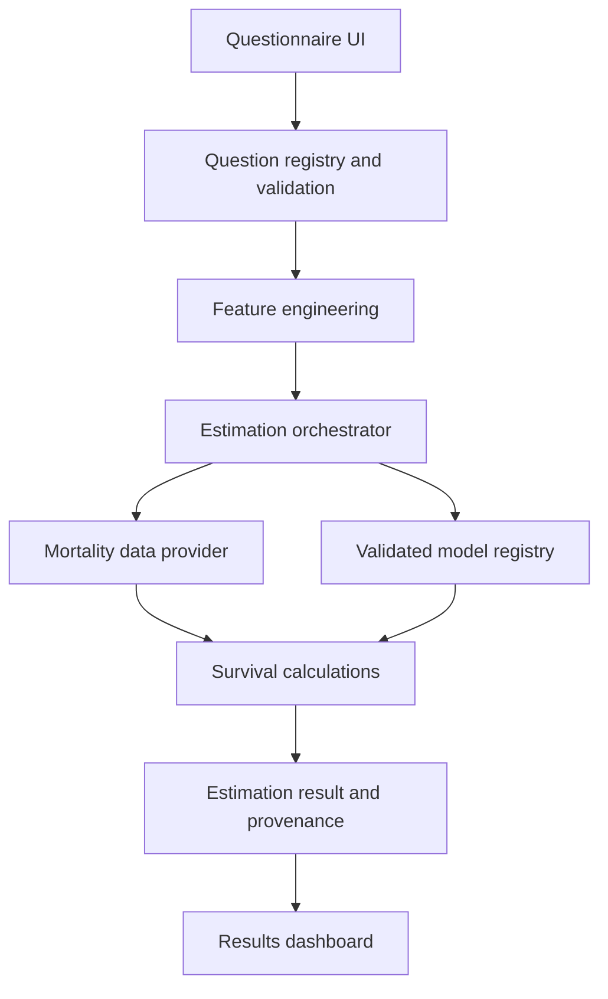

# Architecture

## 1. Goals

The application separates data collection, feature derivation, mortality data, statistical models, survival calculations, and presentation. This makes mathematical functions testable without a UI and allows validated models to be added or replaced without rewriting the questionnaire.

The architecture prioritizes:

- separation of concerns;
- reproducible calculations;
- documented data provenance;
- model applicability checks;
- privacy-minimizing data flow;
- accessible questionnaire and results screens;
- explicit failure states instead of invented outputs.

## 2. Logical architecture

A baseline-only result may use the mortality provider without invoking an individualized model. A personalized result may be produced only when the selected model is applicable and fully configured.

## 3. Suggested source layout

- `src/app/`: page routes and server route handlers.
- `src/components/`: UI components only; do not place statistical coefficients here.
- `src/domain/questionnaire/`: exact question registry, answer types, branching, validation, and display ordering.
- `src/domain/features/`: pure derivation functions, unit conversion, and missing-data handling.
- `src/domain/mortality/`: life-table types, provider contract, parsing, lookup, and integrity validation.
- `src/domain/survival/`: hazard conversion where justified, survival curves, integration, median, and time conversions.
- `src/domain/estimation/`: orchestration, applicability checks, output types, and status selection.
- `src/models/`: model registry, adapters, metadata, versioned coefficients/model artifacts where permitted, and model cards.
- `src/data/mortality/`: approved local tables or import instructions; not application logic.
- `src/data/geographic/`: approved coarse regional data or import instructions.
- `src/lib/`: configuration, typed errors, dates, and non-sensitive logging.
- `tests/`: unit, integration, and end-to-end tests.
- `docs/`: methodology, data provenance, validation, privacy, and architecture.

Keep domain modules framework-independent wherever possible. They should accept typed values and return typed results without importing React components.

## 4. Main contracts

The exact type names may vary, but these concepts should exist:

### Questionnaire definition

A question definition includes a stable ID, exact display text, input type, answer options, optionality, validation schema, conditional visibility rule, and feature mappings. The UI, answer review, and feature pipeline use one registry to avoid inconsistent copies of the questionnaire.

### Mortality table provider

The provider exposes its provenance metadata and documented baseline quantities. It must state the population, data year, source, supported ages/categories, and whether data are period or cohort estimates. Missing data return an explicit unavailable value or typed error; never silently interpolate unless the source/methodology permits it.

### Survival model provider

A model exposes metadata, applicability checks, required features, prediction horizon, and predictions. Model-specific feature transformations must be versioned and consistent with the model’s documentation. Do not assume all models use the same baseline or mathematical formulation.

### Estimation result

Each result includes:

- status: `baseline_only`, `individualized`, or `unavailable`;
- quantity type: full expected remaining lifespan, restricted mean survival time, or another explicitly defined metric;
- numeric estimate and units, where available;
- survival probabilities and their horizons, where supported;
- median survival if estimable;
- uncertainty information only if defensibly calculated;
- data source and version;
- model name/version and applicability status;
- features used, unavailable, and excluded;
- limitations and calculation timestamp.

Do not include raw questionnaire answers in logs or model provenance summaries.

## 5. Request flow

1. The user completes the guided questionnaire.
2. The client validates individual fields and displays a review screen.
3. On submit, validate the entire payload again at the trusted computation boundary.
4. Normalize units and derive only supported features.
5. Select and validate a mortality provider.
6. Evaluate whether a compatible individualized model is configured and applicable.
7. Run baseline-only or validated individualized calculation.
8. Validate all outputs, provenance, limits, and probability invariants.
9. Return a typed result without persisting the assessment by default.
10. Display the result and explain the used inputs, limitations, and data sources.

If the UI and calculation engine run in the same process for the anonymous version, preserve the same module boundaries. If calculations move to a server, minimize payload logging, validate all inputs server-side, enforce rate limits where appropriate, and avoid storing assessment payloads unless explicitly designed and disclosed.

## 6. Error handling

Use typed errors or result objects for at least:

- unsupported population;
- missing required model feature;
- unavailable mortality table;
- incompatible baseline/model assumptions;
- unsupported prediction horizon;
- invalid source data;
- invalid model output;
- calculation failure;
- unavailable uncertainty estimate.

Errors shown to users must be understandable and must not reveal secrets or internal stack traces. Diagnostic logs must not contain the user's raw medical, substance-use, or precise location answers.

## 7. Baseline and individualized modes

**Baseline-only:** use a suitable life table and clearly disclose that the estimate is a population baseline, not individually adjusted. Do not imply that unmodeled questionnaire items changed the result.

**Individualized:** only run a model when metadata and input requirements are satisfied and validation supports the requested use. Model metadata must include a validation record and a supported horizon. If a model is inapplicable, do not fall back to a different model silently; return to baseline-only mode if valid or report unavailable.

## 8. Reproducibility and versioning

Record model and data versions alongside each result. If a file-based source is used, store a cryptographic checksum, import date, and provenance note. Keep coefficient files and model transformations versioned together. Any change to feature definitions, baseline compatibility, coefficients, time horizon, missing-data handling, or integration method requires tests and a review of the validation impact.

## 9. Security boundaries

- Secrets stay in server-only environment variables.
- Any `NEXT_PUBLIC_` variable is public and must never contain secrets.
- The basic questionnaire should work without an account or persistent storage.
- UI validation supplements but does not replace server validation.
- Do not send sensitive answers to analytics, ads, LLMs, or third-party APIs by default.
- Configure least-privilege GitHub Actions permissions.
- Keep datasets out of Git unless license, privacy, and size allow it.

## 10. Deployment assumptions

The reference project assumes a modern Next.js App Router application. Preserve an existing working stack if already established. CI expects a lockfile and a reproducible install. Required and optional npm scripts must be documented in the root README. Production readiness requires more than a successful build: it requires appropriate model validation, legal/privacy review, security testing, and operational monitoring that does not log health answers.
